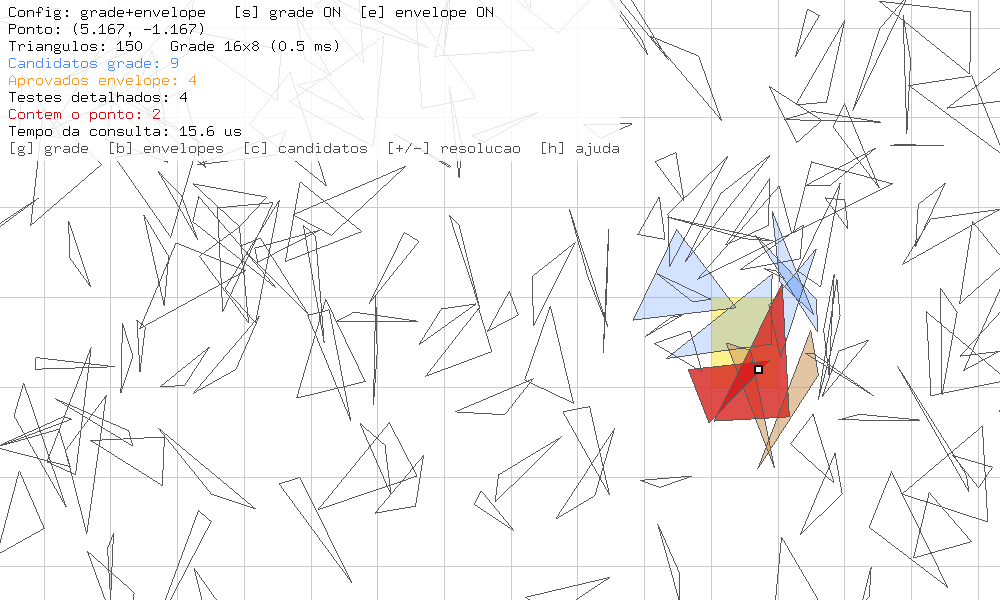
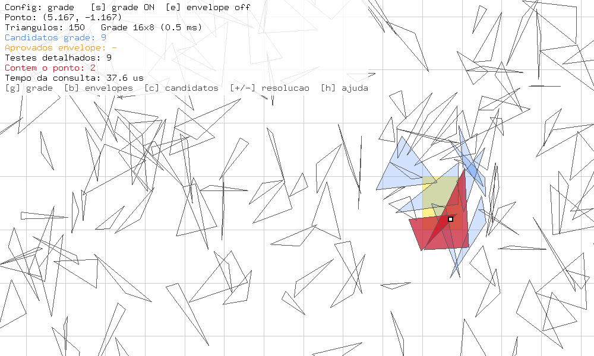
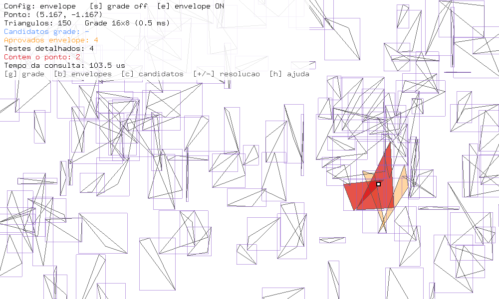
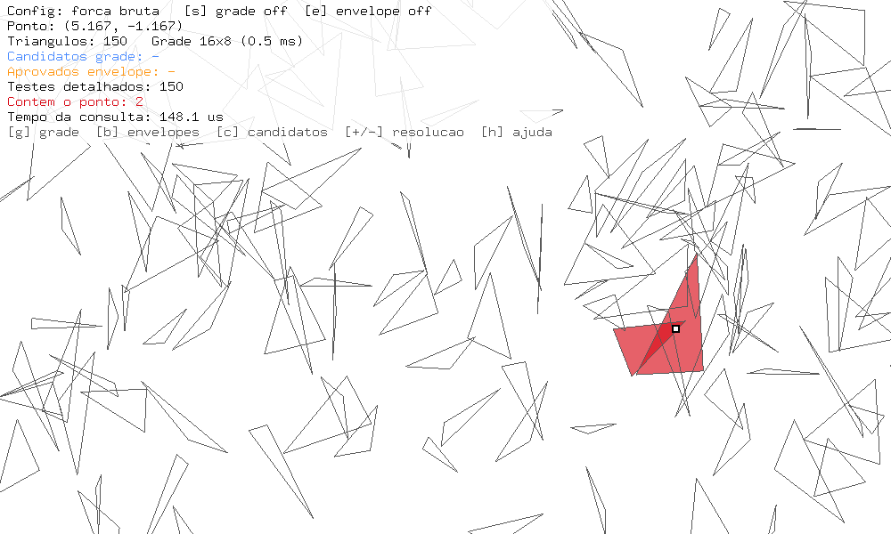
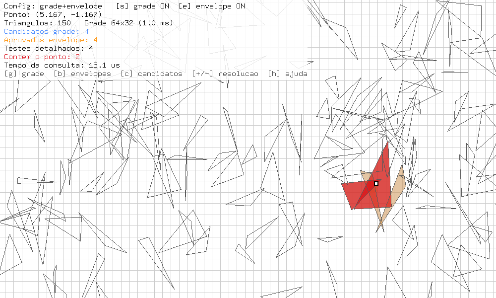
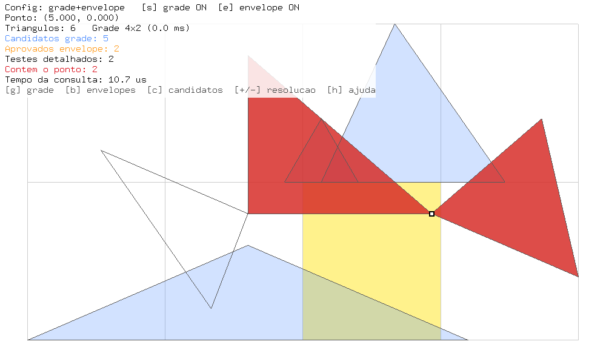

# Trabalho I – Inclusão de Ponto em Polígonos com Aceleração

**Disciplina:** 4645Z-4 – Fundamentos de Computação Gráfica (Prof. Márcio Sarroglia Pinho)

**Integrantes:** Humberto Corrêa e Pedro Idalencio

**Vídeo de demonstração (até 2 min):** <https://youtu.be/Pn1o1ICB_08>

**Repositório:** <https://github.com/HumbertoCG18/T1_CG_2026>

## 1. Como executar

Requisitos: Python 3, `PyOpenGL` e GLUT (freeglut), os mesmos do programa base da disciplina.

```bash
python ProgramaT1.py                                 # 1000 triângulos, semente 1, grade 16x8
python ProgramaT1.py --n 5000 --semente 7 --tamanho 0.5 --grade 32 16
python ProgramaT1.py --arquivo cenarios/exemplo.txt --grade 4 2
python Testes.py                                     # auto-verificação
python Benchmark.py                                  # experimentos deste relatório
```

| Tecla | Ação |
|---|---|
| `s` / `e` | liga/desliga a etapa de subdivisão espacial / de envelopes |
| `1` `2` `3` `4` | força bruta / envelope / grade / grade + envelope |
| `g` / `b` / `c` | mostra/esconde a grade, os envelopes, os candidatos intermediários |
| `+` / `-` | dobra / divide a resolução da grade (a grade é reconstruída) |
| `r` | novo cenário aleatório com a semente seguinte |
| `w` | salva o cenário corrente em `cenarios/` |
| setas, clique e arraste | movem o ponto |
| `h` | imprime a ajuda no console |

## 2. Organização da solução

A separação pedida no enunciado foi feita em módulos:

| Papel | Arquivo | Conteúdo |
|---|---|---|
| Dados geométricos | `Ponto.py`, `Triangulo.py` | classes do programa base; o triângulo guarda as coordenadas globais dos 3 vértices, o envelope (AABB) e as tolerâncias |
| Cenário | `Cenario.py` | geração aleatória com semente, leitura e gravação de arquivo, construção da grade |
| Estrutura de aceleração | `Grade.py` | grade regular NX×NY; cada célula guarda só índices de triângulos |
| Algoritmo de teste | `Consulta.py` | pipeline grade → envelope → teste detalhado, com contadores e tempo |
| Visualização | `ProgramaT1.py` | OpenGL/GLUT, interação, painel de informações |
| Verificação e experimentos | `Testes.py`, `Benchmark.py` | testes automáticos e medições |

## 3. Requisitos e implementação

| Requisito | Como foi atendido |
|---|---|
| N triângulos com coordenadas globais na estrutura do objeto | `Triangulo.Vertices` guarda 3 `Ponto` em coordenadas do universo |
| Geração aleatória com semente registrável/reutilizável | `Cenario.GeraAleatorio` usa `random.Random(semente)` próprio; a semente vem de `--semente`, aparece no console e é gravada no cabeçalho do arquivo salvo com `w` |
| Leitura de arquivo | `Cenario.LeArquivo`; formato: `N` e depois uma linha `x1 y1 x2 y2 x3 y3` por triângulo (`#` inicia comentário). Exemplo em `cenarios/exemplo.txt`. Arquivo vazio, malformado, com `N < 1` ou com `nan`/`inf` gera erro com o nome do arquivo |
| Mesma estrutura para as duas origens | as duas funções devolvem um `Cenario` com a mesma lista de `Triangulo` |
| Triângulos sobrepostos; todos os que contêm o ponto | a consulta devolve a lista de todos os índices aprovados no teste detalhado |
| Controle do ponto por mouse e teclado | clique/arraste (`glutMouseFunc`, `glutMotionFunc`) e setas; `ConverteMouseParaUniverso` converte janela → universo usando o viewport e os limites do `glOrtho` |
| Posição do ponto exibida | painel na janela e uma linha no console a cada consulta |
| Subdivisão espacial | grade regular (`Grade.py`). Cada triângulo é inserido em todas as células que seu envelope toca |
| Envelopes | AABB (`Triangulo.Envelope`, `PontoNoEnvelope`) |
| Teste detalhado | orientação do ponto em relação às três arestas (código do enunciado) em `Triangulo.PontoNoTriangulo` |
| Estruturas só com índices, construídas ao criar/carregar | `Grade.Celulas` é uma lista de listas de `int`; `ConstroiGrade` é chamada ao criar/carregar o cenário (e ao mudar a resolução) |
| Etapas ativáveis em execução; 4 configurações | teclas `s`, `e` e `1`–`4`; `Consulta(cenario, P, usaGrade, usaEnvelope)` |
| Mesmo resultado em todas as configurações | conferido por `Testes.py` (pontos sorteados, vértices e pontos médios de arestas, 4 cenários e grades de 1×1 a 40×20) e por `Benchmark.py`, que interrompe a execução se alguma configuração divergir da força bruta |
| Ponto sobre aresta/vértice pertence ao triângulo, com tolerância | ver seção 4 |
| Visualização das categorias com cores distintas | grade (cinza), célula do ponto (amarelo), envelopes (roxo), candidatos da grade (azul), aprovados no envelope (laranja), triângulos que contêm o ponto (vermelho). Grade, envelopes e candidatos intermediários têm toggles (`g`, `b`, `c`) |
| Visualização não altera o resultado | `display()` só lê o último `Resultado`; a consulta só é refeita quando o ponto, as etapas ou o cenário mudam |
| Informações de desempenho por consulta | `Resultado`: total, candidatos da grade, aprovados no envelope, testes detalhados, triângulos que contêm, tempo (`time.perf_counter`). Um novo `Resultado` é criado a cada consulta, então os contadores começam zerados |

### Capturas de tela

As capturas 1 a 5 usam o mesmo cenário (150 triângulos, semente 1, tamanho 1,2) e o mesmo ponto (5,167; −1,167). Só mudam as etapas ativas e o que está visível. Cores: célula do ponto em amarelo, candidatos da grade em azul, aprovados no envelope em laranja, triângulos que contêm o ponto em vermelho e envelopes em roxo.



**Figura 1 – Grade 16×8 + envelope.** A grade devolve 9 candidatos (azul), o envelope aprova 4 (laranja), são feitos 4 testes detalhados e 2 triângulos contêm o ponto (vermelho).



**Figura 2 – Só a grade.** Os 9 candidatos vão direto para o teste detalhado: 9 testes, mesmo resultado (2 triângulos).



**Figura 3 – Só o envelope, com os envelopes visíveis (`b`).** Os 150 envelopes são verificados, 4 aprovam o ponto e o resultado continua com 2 triângulos.



**Figura 4 – Força bruta.** 150 testes detalhados e o mesmo resultado, que serve de referência para as outras configurações.



**Figura 5 – Grade 64×32 (tecla `+` duas vezes).** A grade já devolve só 4 candidatos, os mesmos 4 que o envelope aprova: com a grade fina o envelope não descarta mais nada (ver seção 7).



**Figura 6 – Cenário lido de `cenarios/exemplo.txt`, ponto exatamente no vértice (5, 0).** Esse vértice é compartilhado por dois triângulos, e os dois são considerados contendo o ponto.

Saída do console para as figuras 1 a 4 (uma linha por consulta; o tempo varia entre execuções):

```
P=(5.167, -1.167) [grade+envelope] total=150 grade=9 envelope=4 testes=4 contem=2 tempo=18.5us
P=(5.167, -1.167) [grade] total=150 grade=9 envelope=- testes=9 contem=2 tempo=37.6us
P=(5.167, -1.167) [envelope] total=150 grade=- envelope=4 testes=4 contem=2 tempo=103.5us
P=(5.167, -1.167) [forca bruta] total=150 grade=- envelope=- testes=150 contem=2 tempo=148.1us
```

## 4. Tolerância numérica

No teste de orientação, `d = (comprimento da aresta) × (distância do ponto à reta da aresta)`. Em vez de comparar `d` com zero, cada `d` é comparado com `EPSILON × comprimento da aresta` (pré-calculado em `CalculaTolerancias`). Assim a tolerância vale `EPSILON = 1e-9` unidades **de distância**, qualquer que seja o tamanho do triângulo. `Testes.py` confirma que pontos sobre vértices e arestas (inclusive a hipotenusa, que em ponto flutuante pode cair um pouco fora) são aceitos e que pontos a `1e-6` de distância, do lado de fora, são rejeitados.

A tolerância "infla" um pouco o triângulo, e o efeito é maior perto de vértices muito agudos. Para que a grade e o envelope nunca descartem um ponto que o teste detalhado aceitaria:

- envelopes e grade usam uma margem `MARGEM_ENVELOPE = 1e-5`, maior que esse inchaço;
- triângulos quase degenerados (`menor altura / maior aresta < 1e-3`) são descartados na geração e na leitura, com aviso. Sem isso, um triângulo de vértices colineares aceitaria pontos sobre toda a reta, fora do envelope, e a força bruta discordaria das versões aceleradas.

A grade usa a mesma função (`IndiceDaCelula`) para inserir triângulos e localizar o ponto. Por isso um ponto exatamente sobre a fronteira entre células cai sempre numa célula que contém os triângulos certos.

## 5. Metodologia dos experimentos

`Benchmark.py` parte de uma configuração base e varia **um fator por vez**:

- base: 1000 triângulos, semente 1, tamanho 1,0, grade 16×8, pontos uniformes;
- área do cenário: [-10, 10] × [-5, 5]; cada triângulo tem o centro sorteado nessa área e os vértices sorteados num quadrado de meio-lado `tamanho` ao redor do centro;
- conjuntos de pontos (semente fixa 999, iguais para as 4 configurações): `uniforme` (sorteados na área), `centroides` (centro de triângulos sorteados, sempre dentro de pelo menos um) e `fora` (faixa acima da grade);
- 100 pontos por cenário e 5 repetições. Em cada repetição, as 4 configurações rodam intercaladas, ponto a ponto, para que um pico de carga da máquina afete todas igualmente. Vale o menor tempo de cada ponto em cada configuração;
- o tempo de construção da grade é o menor de 3 construções;
- valores apresentados: médias por consulta. *Speedup* = tempo da força bruta / tempo da configuração.

A configuração base aparece em 6 tabelas, o que dá uma medida do ruído: a força bruta variou entre 616,5 e 637,5 µs e grade+envelope entre 9,4 e 10,1 µs. Os tempos são de Python puro numa única máquina. Os valores absolutos dependem do computador; as proporções entre configurações é que importam. A tabela completa está em `resultados/benchmark.md` e `resultados/benchmark.csv` e é refeita com `python Benchmark.py` (cerca de 20 s).

## 6. Resultados

### 6.1 Quantidade de triângulos (grade 16×8, tamanho 1,0)

| N | força bruta (µs) | envelope (µs) | grade (µs) | grade+envelope (µs) | candidatos grade | aprovados envelope | contêm | construção da grade (ms) |
|---|---|---|---|---|---|---|---|---|
| 100 | 64,6 | 14,3 | 2,9 | 2,2 | 2,3 | 0,5 | 0,1 | 0,32 |
| 1000 | 616,5 | 142,7 | 19,7 | 10,1 | 26,5 | 4,8 | 1,3 | 2,07 |
| 5000 | 3116,7 | 725,7 | 97,8 | 44,3 | 136,6 | 24,7 | 7,5 | 11,97 |
| 20000 | 13220,5 | 3629,4 | 524,9 | 263,9 | 544,6 | 96,3 | 29,4 | 52,24 |

### 6.2 Tamanho médio dos triângulos (N = 1000, grade 16×8)

| tamanho | índices/célula | candidatos grade | aprovados envelope | contêm | speedup envelope | speedup grade | speedup grade+envelope |
|---|---|---|---|---|---|---|---|
| 0,2 | 10,2 | 10,1 | 0,2 | 0,1 | 4,4 | 69,3 | 189,2 |
| 1,0 | 23,2 | 26,5 | 4,8 | 1,3 | 4,2 | 31,5 | 64,5 |
| 3,0 | 56,7 | 90,4 | 38,1 | 11,3 | 3,4 | 10,2 | 14,1 |
| 6,0 | 101,5 | 214,6 | 123,2 | 38,8 | 2,4 | 4,5 | 4,9 |

### 6.3 Resolução da grade (N = 1000, tamanho 1,0)

| grade | índices no total | índices/célula | candidatos grade | grade (µs) | grade+envelope (µs) | speedup grade | speedup grade+envelope | construção (ms) |
|---|---|---|---|---|---|---|---|---|
| 1×1 | 1000 | 1000,0 | 1000,0 | 622,8 | 147,6 | 1,01 | 4,25 | 1,87 |
| 4×2 | 1289 | 161,1 | 161,4 | 110,1 | 29,9 | 5,67 | 20,90 | 2,37 |
| 16×8 | 2973 | 23,2 | 26,5 | 20,1 | 9,9 | 31,64 | 64,66 | 2,10 |
| 64×32 | 14519 | 7,1 | 8,7 | 7,8 | 6,7 | 80,30 | 93,67 | 4,07 |
| 128×64 | 44003 | 5,4 | 6,8 | 6,5 | 6,3 | 96,38 | 99,43 | 7,29 |

### 6.4 Semente, posição dos pontos e arquivo

- **Semente** (1, 2, 3): candidatos da grade entre 25,1 e 26,5, *speedup* de grade+envelope entre 64,7 e 67,2. O comportamento não depende de uma semente específica.
- **Pontos `centroides`:** 2,2 triângulos contêm o ponto, em média, contra 1,3 nos pontos uniformes; os tempos quase não mudam (10,4 µs contra 9,8 µs em grade+envelope).
- **Pontos `fora`:** a grade descarta tudo só ao ver que o ponto está fora de seus limites: 0,7 µs contra 626,6 µs da força bruta. O envelope sozinho ainda testa os 1000 envelopes (145,6 µs).
- **Arquivo `exemplo.txt`** (6 triângulos): todas as configurações ficam entre 1,7 e 4,1 µs.

## 7. Discussão

**Onde a aceleração reduz o trabalho.**

- A força bruta cresce linearmente com N (64,6 µs → 13,2 ms de 100 para 20000 triângulos).
- O envelope sozinho dá um ganho quase constante, entre 3,6× e 4,5×. Ele continua visitando os N triângulos; só troca o teste detalhado (três produtos vetoriais) por quatro comparações. Por isso não muda a ordem de crescimento.
- A grade reduz os triângulos visitados à ocupação de uma célula. Com a resolução adequada, ela dá de 31× a 96× sozinha e até 189× combinada com o envelope (triângulos pequenos).
- A combinação funciona porque as etapas filtram coisas diferentes. A grade elimina os triângulos distantes. O envelope elimina os triângulos da mesma célula cujo AABB não contém o ponto: de 26,5 para 4,8 candidatos na base.
- Pontos fora da área ocupada são o melhor caso da grade: a consulta termina antes de visitar qualquer triângulo.

**Onde o custo não compensa.**

- **Grade grossa demais (1×1):** todos os triângulos ficam na única célula. A grade sozinha empata com a força bruta (1,01×).
- **Grade fixa com N crescente:** com 16×8 e 20000 triângulos, cada célula guarda 452 índices em média e o ganho de grade+envelope cai de 61× (N = 1000) para 50×. A resolução precisa crescer junto com N.
- **Grade fina demais:** de 64×32 para 128×64 os candidatos caem só de 8,7 para 6,8 e o tempo de grade+envelope de 6,7 para 6,3 µs. Em troca, a construção sobe de 4,1 para 7,3 ms e a memória de 14519 para 44003 índices, porque cada triângulo passa a ocupar mais células.
- **Envelope sobre uma grade fina:** a diferença entre "grade" e "grade+envelope" encolhe conforme a grade fica fina: 20,1 → 9,9 µs em 16×8, 7,8 → 6,7 µs em 64×32 e 6,5 → 6,3 µs em 128×64. Sobram tão poucos candidatos que o teste de envelope quase não evita trabalho.
- **Triângulos grandes (tamanho 6,0):** cada triângulo ocupa muitas células (101,5 índices por célula). Muitos realmente contêm o ponto (38,8 em média) e precisam passar pelo teste detalhado de qualquer forma. O ganho cai para 4,9×.
- **Cenários muito pequenos (6 triângulos):** a diferença absoluta é de 2 a 3 µs e não faz diferença para o usuário.
- **Custo de construção:** com N = 1000 a grade custa 2,1 ms e economiza cerca de 0,6 ms por consulta; com N = 20000 custa 52 ms e economiza cerca de 13 ms por consulta. Nos dois casos ela se paga depois de 3 a 4 consultas. Num programa interativo, em que o ponto se move continuamente sobre um cenário estático, isso sempre acontece. Numa consulta única, não.

**Escolha da resolução.** O ganho cresce rápido até cada célula guardar poucas dezenas de índices (16×8 para 1000 triângulos de tamanho 1,0). A partir daí ele continua crescendo devagar, enquanto o custo de construção e a memória crescem mais rápido. A resolução ideal cresce com N e diminui com o tamanho dos triângulos. Por isso ela é um parâmetro (`--grade` e teclas `+`/`-`), não um valor fixo.

## 8. Conclusão

As quatro configurações produziram exatamente o mesmo conjunto de triângulos em todos os cenários testados, inclusive em pontos sobre vértices e arestas. A grade é a etapa que muda a ordem de crescimento do custo. O envelope é um filtro barato que complementa a grade, mas perde utilidade quando a grade já deixa poucos candidatos. Nenhuma das duas compensa com triângulos grandes em relação à célula ou com resolução mal escolhida.
